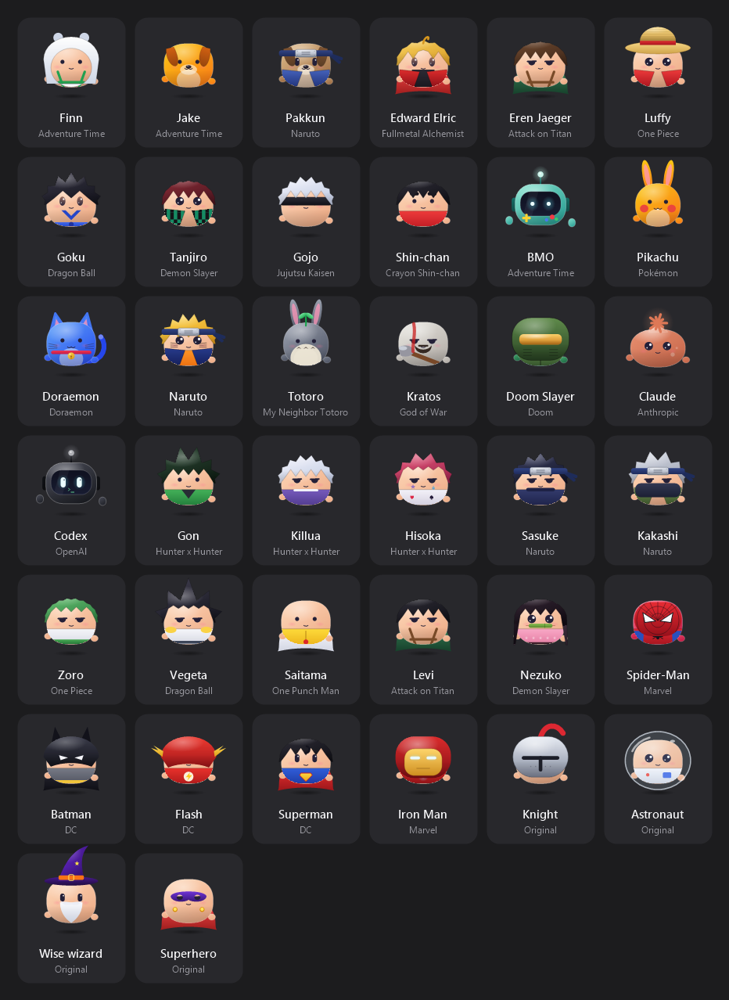

<div align="center">



<h1>Capture, annotate and share in seconds</h1>

Press <kbd>Print Screen</kbd>, select, and you are done. Every capture sits in a floating thumbnail that you can copy, annotate or drag wherever you want.

[](https://github.com/rubenitx/stackshot/releases/latest/download/Stackshot.exe) [](https://stackshot.rubenitx.me/#video-en)

Free and open source · 2.2 MB · No admin rights<br>
For Windows 10 and 11 · Version 2.1.0 · Also as an [MSI package](https://github.com/rubenitx/stackshot/releases/latest/download/Stackshot.msi)

[](https://github.com/rubenitx/stackshot/releases/latest) [](https://github.com/rubenitx/stackshot/releases) [](https://github.com/rubenitx/stackshot/actions/workflows/build.yml) [](LICENSE)

[Website](https://stackshot.rubenitx.me) · [Español](README.es.md) · [Changelog](CHANGELOG.md) · [Security](SECURITY.md) · [IT policies](docs/it-policies.md)

<a href="https://stackshot.rubenitx.me/#video-en"></a>

</div>

**Contents:** [Three steps](#three-steps-no-menus) · [What's new](#whats-new-in-21) · [Features](#features-at-a-glance) · [Modes](#seven-ways-to-capture) · [Capture](#select-snap-done) · [Mark up](#mark-it-up-in-seconds) · [Hide data](#hide-it-before-you-share-it) · [Scrolling](#capture-the-whole-page) · [Record](#record-your-screen-with-sound) · [History](#find-it-by-what-it-said) · [XML and Markdown](#xml-and-markdown-upgraded) · [Main window](#one-window-your-way) · [Pixel](#meet-pixel-39-costumes) · [More](#and-so-much-more) · [Performance](#small-fast-private) · [Installation](#installation) · [Command line](#command-line-and-it-policies) · [Shortcuts](#keyboard-shortcuts) · [Privacy](#privacy-and-security) · [FAQ](#faq) · [Build](#building-from-source) · [License](#license)

> [!NOTE]
> The user interface is in English and Spanish: it follows your Windows language, and **Settings › General › Appearance › Language** changes it. Screenshots on this page show the Spanish interface.

## Three steps, no menus

<table>
<tr>
<th align="center" width="33%">1 · <kbd>Print Screen</kbd></th>
<th align="center" width="33%">2 · Editor</th>
<th align="center" width="33%">3 · <kbd>Ctrl</kbd> + <kbd>V</kbd></th>
</tr>
<tr>
<td align="center" valign="top"><b>Capture</b><br>An area, a window, the whole screen or a scrolling page. Seven modes, each with its own shortcut.</td>
<td align="center" valign="top"><b>Mark it up</b><br>Arrows, shapes, numbered steps, text, highlight and redaction. And a backdrop with padding and shadow if you are presenting it.</td>
<td align="center" valign="top"><b>Share it</b><br>It is already copied. Paste it anywhere, or drag the thumbnail into a chat, an email or a document.</td>
</tr>
</table>

## What's new in 2.1

Version 2.1 is out. Here is what it adds; every change is in the [changelog](CHANGELOG.md).

- **Find a capture by what it said.** [Historial](#find-it-by-what-it-said) lists every capture, video and GIF by day, and its search also reads the text inside the images, on your computer.
- **Cover sensitive data.** One click in the editor, or automatically on every capture, [covers ID numbers, IBANs, cards, e-mails and phones](#hide-it-before-you-share-it).
- **More control over captures.** The [mouse pointer](#select-snap-done) can appear in captures, file names are built from a template, saved captures can go into monthly folders, and **Repetir área** captures the last area again.
- **Recording upgrades.** [Pause and resume](#record-like-a-pro), show clicks and keyboard shortcuts, test the microphone with a live meter, choose options and a countdown before recording, and turn any marked piece of a video into a GIF.
- **A verified lossless "Cine" master and a built-in player.** Cine decodes the file after recording and compares it frame by frame; videos open in [Stackshot's own player](#trim-it-speed-it-up-share-it), and MP4 exports can target 16 MB or 25 MB.
- **Copy text from the screen.** [Select an area and its text goes to the clipboard](#and-so-much-more), using the OCR built into Windows.
- **XML for web services.** [SOAP messages](#xml-and-markdown-upgraded) get a summary bar, a side-by-side comparison, JSON copy and base64 attachments; XML files that appear in a folder can open on their own.
- **Markdown for documentation.** [Pasted pictures and spreadsheet tables, an outline panel and PDF export with real text](#xml-and-markdown-upgraded).
- **Find any setting.** A [search field in the main window](#one-window-your-way), and settings pages that start with a strip of chips.
- **Accessibility.** Controls announce their name, role and state to screen readers, everything works from the keyboard, and Windows contrast themes are followed.
- **Stackshot's own notices** replace the Windows tray balloons.
- **Command line and IT policies.** [`--capture <mode>`, `--open-home` and `--last-xml`](#command-line-and-it-policies), and registry values to fix the save folder or turn features off.

<details>
<summary>Version 2.0</summary>
<br>

- **A complete redesign.** One design system in light and dark, a main window like macOS System Settings, rounded floating thumbnails and a tray panel instead of a context menu.
- **Home, your way.** Three home views (Minimal, Widgets and Scene) with your latest captures one click away.
- **Markdown and XML viewers.** Open `.md` and `.xml` files right from Explorer.
- **Better recording.** Pick the exact speakers and microphone, external cameras just work, and the bar waits until every device is ready.
- **Faster everywhere.** The area picker answers in 1.6 ms, and the main window opens in about a quarter of a second and barely touches the CPU while idle.
- **Updates that find you.** Verified with SHA-256 and a signature, and optionally installed on their own at a quiet moment.
</details>

## Features at a glance

**Stackshot is a free, open source screenshot tool and screen recorder for Windows 10 and 11.** It brings the CleanShot X workflow to Windows. If you are looking for an alternative to ShareX, Snagit, Greenshot or Lightshot, it is a free, MIT-licensed option with floating thumbnails, a quick editor, no accounts and no telemetry.

| Feature | Notes |
|---|---|
| Screenshots of an area, a window or the whole screen | <kbd>Print Screen</kbd>, <kbd>Alt</kbd>+<kbd>Print Screen</kbd>, <kbd>Ctrl</kbd>+<kbd>Print Screen</kbd> |
| Scrolling capture, also saved as paginated PDF | Manual or automatic scrolling |
| Floating thumbnails: copy, save, drag into any app, pin above windows | Up to 20 at once |
| Annotation editor: arrows, rectangles, steps, text, highlight, pixelate, redact, crop | Every mark stays editable |
| Presentation backdrop (gradient, wallpaper or your image) | Also for recordings |
| Copy text from the screen (OCR) | Uses the OCR built into Windows; nothing leaves your computer |
| Cover sensitive data (ID numbers, IBAN, cards, e-mails, phones) | Editor button; automatic covering is off by default |
| History with search inside the images | The text index can be turned off or deleted |
| Video (MP4) and GIF recording | FFmpeg is downloaded the first time you record, after you accept |
| Computer sound, microphone and webcam bubble | Chosen device for each |
| Lossless "Cine" master, verified after recording | A quality option in Grabación |
| Pause, show clicks and keys, microphone meter | Clicks and keys are off by default |
| Built-in video player, trim, join, MP4 and GIF export | Plays MP4, MOV, MKV, WebM, AVI, WMV, TS and more |
| Markdown viewer and editor, with PDF export | |
| XML viewer with SOAP tools and comparison | |
| Search for any setting | <kbd>Ctrl</kbd>+<kbd>F</kbd> in the main window |
| Light and dark themes, screen reader support, high contrast | |
| Mascot (Pixel) with 39 character costumes | On the desktop only if you ask |
| Command line, MSI package and registry policies | For IT departments and keypad buttons |
| Updates verified with SHA-256 and a signature | Automatic installation is off by default |
| No accounts, no telemetry, MIT license | |

## Seven ways to capture.

**Seven ways to capture, each with its own shortcut.**

<div align="center">

</div>

<details>
<summary>How it works</summary>
<br>

An area, the whole screen, a window, a long page, a video, a GIF or a Markdown document: each one has its own shortcut, and all of them start from <kbd>Print Screen</kbd>. The full list is in [Keyboard shortcuts](#keyboard-shortcuts).
</details>

## Select. Snap. Done.

**Press Print Screen, drag over anything, and it waits in the corner.**

<div align="center">

</div>

<details>
<summary>How it works</summary>
<br>

- **Precise selection.** The screen freezes instantly. Drag an area with live dimensions, or hover a window to highlight it and click to capture it, rounded Windows 11 corners included.
- **Repeat the last area.** **Repetir área** captures the same area again without choosing it, from the tray or from **Atajos** (no shortcut by default; you can assign one). If a monitor it touched has changed, the usual picker opens instead.
- **Names and folders your way.** In General > Capturas guardadas, build file names from the type, date, time, app, window title, year, month, day or a counter that never repeats, with a live example. **Subcarpetas** keeps saved captures in one folder per month (`2026-10`) or per year and month (`2026\10`). The default gives the same names as before.
- **The mouse pointer, if you want it.** General > Al capturar > **Incluir el puntero** draws the pointer, as it was when the capture started, into area, screen and window captures. Off by default.
</details>

### Drag it anywhere.

**Into a chat, an email or a document. Or paste it with Ctrl+V.**

<details>
<summary>How it works</summary>
<br>

- **Floating stack.** Every capture appears as a thumbnail in the corner. Hover it for **Copiar** and **Guardar** (Copy and Save), drag it into any app, swipe it away, or scroll through up to 20. It follows the mouse across monitors and never shows up in screen sharing.
- **Straight to the clipboard.** Each screenshot is copied as soon as it is taken, ready for <kbd>Ctrl</kbd>+<kbd>V</kbd> (videos and GIFs are copied as files). It is never synced through the Windows cloud clipboard.
</details>

## Mark it up in seconds.

**Arrows, shapes, numbered steps, text, highlight and redaction.**

<div align="center">

</div>

<details>
<summary>How it works</summary>
<br>

- **Editor.** Curved arrows, lines, rectangles, ellipses, numbered steps, text, highlighter, a spotlight that dims everything outside an area, pixelation, solid redaction that really removes what is underneath, and non-destructive cropping. Every mark can be moved, resized or deleted later, and the canvas zooms around the pointer.
- **Export.** Copy, save as PNG or PDF, or drag the result straight out of the editor.
</details>

### Then make it beautiful.

**Backdrops, padding, rounded corners and shadow. For videos too.**

<details>
<summary>How it works</summary>
<br>

- **Presentation backdrop.** A sidebar like CleanShot X's puts a capture on a gradient, your blurred wallpaper, an image of your own, the capture itself blurred or a plain colour, with padding, an inset in the capture's own edge colour (auto-balanced if you like), shadow, rounded corners, alignment and a fixed aspect ratio. Recordings get the gradients, pictures and colours.
</details>

## Hide it before you share it.

**One click finds IDs, IBANs, cards, e-mails and phone numbers, and covers them.**

<div align="center">

</div>

<details>
<summary>How it works</summary>
<br>

Share a screenshot without sharing what shouldn't be in it. The editor's **Datos sensibles** button (<kbd>Ctrl</kbd>+<kbd>Shift</kbd>+<kbd>X</kbd>) finds Spanish DNI and NIE numbers, Social Security numbers, IBANs, card numbers, e-mail addresses and phone numbers, and covers each one with a redaction mark you can remove. It checks control digits, so invoice numbers, amounts and dates are left alone.

Detection can miss data, so look over the result before you share it.
</details>

### Or let it happen by itself.

**Turn it on once and every capture is checked first. It all stays on your PC.**

<details>
<summary>How it works</summary>
<br>

To do it on every capture, turn on General > Datos sensibles > **Tapar los datos sensibles al capturar**. The thumbnail says "Revisando datos…" for a moment (about 0.4 s at 1080p), and the clipboard, the file and the thumbnail only ever get the covered image. It is **off by default**, everything is read on your computer, and the uncovered original is kept in `%LOCALAPPDATA%\Stackshot\originales` only while the capture exists, so a cover can still be removed in the editor.

Detection can miss data, so look over the result before you share it.
</details>

## Capture the whole page.

**Scroll yourself, or let Stackshot scroll for you. One seamless image.**

<div align="center">

</div>

<details>
<summary>How it works</summary>
<br>

Select an area and scroll, or let Stackshot scroll for you. The frames are stitched into one seamless image without repeating sticky headers or footers. Long captures open fitted to the width, ready to read, and can be saved as a paginated PDF.
</details>

## Record your screen. With sound.

**MP4 or GIF at up to 60 fps, with sound and with your webcam if you like.**

<div align="center">

</div>

<details>
<summary>How it works</summary>
<br>

Record an area as **MP4 or GIF**, with the cursor, at up to 60 fps. Add the computer's sound and your microphone, each from the device you choose and in sync with the image, and your webcam in a round or square bubble. The first time you record, Stackshot offers to download FFmpeg (see [Privacy and security](#privacy-and-security)).

Before recording, a small window lets you adjust the options (quality, frame rate, sound, microphone, camera) and starts a countdown of 3 seconds by default (0, 3, 5 or 10; it never appears in the video). **Grabación > Antes de grabar** turns the window off or changes the countdown.

Quality goes from light and fast to **Cine** (Cinema): a truly lossless master (RGB H.264 + PCM in MKV) that Stackshot decodes after recording and checks frame by frame against what it captured. Areas above 1920 × 1200 at 60 fps ask before starting. If the computer cannot keep up, or the disk is filling, the recording stops cleanly and keeps what it has, and anything that fails afterwards is moved to `%LOCALAPPDATA%\Stackshot\recuperado`.
</details>

### Trim it. Speed it up. Share it.

**Trim the ends and export at 1.5× or 2×, in 1080p or 720p.**

<details>
<summary>How it works</summary>
<br>

When you stop, trim the start and end with the yellow handles, add more videos, change the speed (1.5× or 2×), the size (1080p or 720p), the format or the quality, add marks and a backdrop, and export. MP4 quality can be **Máxima** (default), **Alta**, **Ligera**, or fit a size: **16 MB (WhatsApp)** or **25 MB (correo)**, encoded in two passes (a video too long to fit with decent quality is refused, saying how long fits). Every MP4 is checked before it's handed to you.

**Built-in video player.** Videos open in Stackshot's own player, with no VLC and no extra codecs: Cine masters always, other videos by default (Grabación > Después de grabar). It plays MP4, MOV, MKV, WebM, AVI, WMV, TS and more, with speed from 0.25× to 2× keeping the pitch, frame-by-frame stepping, a choice of sound track and an info panel. Videos open at their real size when the window fits on screen, and a video longer than two minutes opens where you left off. <kbd>C</kbd> saves the frame on screen as a picture. General > Archivos can offer Stackshot for `.mkv` files, which Windows' own player cannot decode.
</details>

## Record like a pro.

**Pause and resume, show clicks and shortcuts, and test your mic before you start.**

<div align="center">

</div>

<details>
<summary>How it works</summary>
<br>

- **Pause and resume** from the recording bar, the tray or the command line, in every quality. What happens during a pause is not in the file, and sound and image stay in sync.
- **Show clicks and keys (optional).** Grabación > Clics y teclas draws a ring where you click (blue for left, orange for right) and shows shortcuts such as "Ctrl + C" at the bottom of the video. What you type is never shown, so passwords don't end up in the video. Both are off by default, and the keyboard and mouse are only watched while a recording with one of them on is running.
- **Test the microphone.** **Probar micrófono** and the **Nivel de entrada** meter show the live level, warn when it clips (**Saturando**) and say when no microphone is available. A recording also reports when the sound clipped.
- **A GIF of a piece.** In the player, mark a piece with <kbd>E</kbd> and <kbd>S</kbd> and press <kbd>G</kbd> to make a GIF of just that part.
</details>

## Find it by what it said.

**Search the text inside your captures. Windows' own OCR reads them, on your PC.**

<table>
<tr>
<td width="50%" valign="top"></td>
<td width="50%" valign="top"></td>
</tr>
</table>

<details>
<summary>How it works</summary>
<br>

The **Historial** section lists every capture, video and GIF by day, with thumbnails, filters (Todo, Capturas, Vídeos, GIF) and a search that also looks inside the images. Stackshot reads the text of each capture in the background with the OCR built into Windows, on your computer (paused while you capture or record), so you can find last week's error message by typing a word that was in it. Matches are highlighted in a snippet of what the capture said.

The history covers the newest 5,000 captures, saved ones and dated subfolders included. The text index lives in `%LOCALAPPDATA%\Stackshot\historial`; General > Recientes turns the reading off and deletes it (**Buscar por el texto de las capturas**), and **Borrar el índice de texto** empties it.
</details>

## XML and Markdown, upgraded.

**Compare two XMLs, read SOAP at a glance, copy as JSON. Export Markdown to PDF.**

<table>
<tr>
<td width="50%" valign="top"></td>
<td width="50%" valign="top"></td>
</tr>
</table>

<details>
<summary>How it works</summary>
<br>

Open `.md` and `.xml` files from Explorer (optional; Windows keeps the final choice), paste them, or drop them on the window. Markdown is rendered with headings, lists, tables, code and quotes, with an editor beside it, find and replace, validation and **Ordenar** (Tidy). XML becomes a colored, collapsible, searchable tree with formatting, compacting, XPath, validation and copy as an image. Both viewers keep each file's encoding and line endings, and ask before discarding unsaved changes.

**XML and SOAP**

- **SOAP summary bar.** A SOAP message shows its operation, time and size and an OK or **Fault** chip with the fault's code and message in red, with buttons for the XML before and after in the folder.
- **Compare two XML files.** **Comparar con el XML anterior de la carpeta** or **Comparar con otro archivo…** shows changed, added and removed nodes in the tree, ignoring whitespace, attribute order and namespace prefixes. <kbd>F7</kbd> and <kbd>Shift</kbd>+<kbd>F7</kbd> go through the differences, and "only differences" hides the rest.
- **Copy as value or JSON.** Right-click a node to copy its value, an attribute's value or the whole branch as JSON.
- **Escaped XML and base64 attachments.** XML escaped inside a field opens as one more branch of the tree, and a file carried in base64 opens or saves with one click. Programs, scripts, shortcuts, ZIP files and Office files with macros are only saved, never opened.

<div align="center">

</div>

General > Avanzado can watch a folder: every new XML that appears in it opens by itself in the viewer, in front of everything, and <kbd>[</kbd> <kbd>]</kbd> go to the previous or next one. It is meant for programs that leave each SOAP message as an XML file in a folder: it only appears when your IT department sets that folder (the `XmlWatchFolder` policy, see [docs/it-policies.md](docs/it-policies.md)) or where it was already set up, and it is off by default. From the command line, `--last-xml` opens the newest one.

**Markdown for documentation**

- **Pictures.** Paste or drop a picture into a saved document and it is stored in an `imagenes` folder next to it, with the link inserted. Pictures on other computers or on the web are never loaded just by opening a document.
- **Spreadsheet tables.** Paste cells from Excel, LibreOffice or Google Sheets and they become a Markdown table (<kbd>Ctrl</kbd>+<kbd>Shift</kbd>+<kbd>V</kbd> pastes plain text). Pressing <kbd>Enter</kbd> in a numbered list renumbers the items below it.
- **Outline.** The **Índice** button opens a side panel with the H1 to H3 headings that jumps to each one and follows where you are.
- **PDF with real text.** **Exportar PDF…** writes A4 pages with selectable text, embedded fonts, page numbers and bookmarks.
</details>

## One window. Your way.

**Three home views, every mode and every setting in one place.**

<div align="center">

</div>

<table>
<tr>
<td width="50%" valign="top"><br><b>Light or dark.</b> It follows Windows, or you pick one.</td>
<td width="50%" valign="top"><br><b>Always one click away.</b> Every mode and your latest captures, from the tray.</td>
</tr>
</table>

<details>
<summary>How it works</summary>
<br>

Every capture mode, shortcut and setting in one place: Inicio, Historial, Atajos, General, Fondo y editor, Grabación, Mascota and Acerca de. Choose how home looks: **Minimalista** (the mascot, one question and every mode), **Widgets** (today at a glance: the last capture, captures per day, recording and the folder) or **Escena** (Scene). Quick profiles (**Rendimiento**, **Equilibrado**, **Completo**: Performance, Balanced, Complete) set everything in one click.

**Find any setting.** A search field at the top of the sidebar (<kbd>Ctrl</kbd>+<kbd>F</kbd>) finds any setting as you type, ignoring accents and case, with every word in any order and the usual synonyms (typing "micro" finds the microphone). Results are grouped by section; <kbd>Enter</kbd> opens one and the row glows for a moment. The long General and Grabación pages start with chips that jump to each group.

<div align="center">

</div>

**Accessible and readable.** Screen readers (Narrator, NVDA) can read and use every control, everything works from the keyboard with a visible focus ring, and Windows contrast themes are followed. Stackshot's own notices, with action buttons where they help, replace the Windows tray balloons; they never take focus and stay out of captures and screen sharing.

**Light or dark.** Stackshot follows Windows, or you pick light or dark in General > Apariencia. Everything switches live, no restart needed.

**Always one click away.** Closing the window keeps Stackshot in the tray. A click on its icon opens a panel with every mode and its shortcut as keycaps, your four latest captures, and quick access to the window, your saved captures and the settings. The arrow keys and <kbd>Enter</kbd> work too.
</details>

## Meet Pixel. 39 costumes.

**Your capture sidekick, with 39 costumes. It can even live on your desktop.**

<table>
<tr>
<td width="50%" valign="top"></td>
<td width="50%" valign="top"></td>
</tr>
</table>

<details>
<summary>How it works</summary>
<br>

Meet **Pixel**: twelve species, 23 colors, eye styles, dozens of hats, outfits and accessories, three personalities and friendship levels that unlock extras. It celebrates your captures and gives tips. You can switch it off in the settings, and an organization can switch it off for everyone.

If you want, it lives on your desktop: it walks above the taskbar, hops onto the window in front of you, rides along when you move it and naps when you are away. And it is invisible to screenshots, recordings and screen sharing, so it never ends up in your captures.

The **Personajes** (Characters) section dresses it up as fan tributes to characters from anime, series, comics and games, plus a few originals: **105 in total**. One click and it becomes Pikachu, Chopper or Spider-Man; hovering a costume shows where it comes from.

<details>
<summary>All 39 character costumes</summary>
<br>
<div align="center">

</div>
</details>
</details>

## And so much more.

**The small things, all in the same 2.2 MB.**

<table>
<tr>
<td width="50%" valign="top"><br><b>Select first, decide after.</b> Adjust the area, then capture, record or scroll.</td>
<td width="50%" valign="top"><br><b>Pin it above everything.</b> Wheel to zoom, Ctrl + wheel to fade it.</td>
</tr>
</table>

<details>
<summary>How it works</summary>
<br>

**Select first, decide after.** Turn on **all-in-one mode** (General > Al capturar > Después de seleccionar un área > **Mostrar opciones**) and the area stays on screen after you select it, with handles to move and resize it (the arrow keys work too) and a bar to choose **Capturar**, **Vídeo**, **GIF** or **Desplazar** (capture, video, GIF or scrolling). <kbd>Enter</kbd> or a double click captures.

**Pin it above everything.** Pin any capture from its thumbnail and it floats above every window: the wheel zooms it, <kbd>Ctrl</kbd>+wheel changes its opacity, dragging moves it, and a double click or <kbd>Esc</kbd> closes it. Perfect for copying values from one window to another.

**Copy text with OCR.** Select an area with <kbd>Ctrl</kbd>+<kbd>Shift</kbd>+<kbd>Alt</kbd>+<kbd>T</kbd> and its text goes to the clipboard, ready to paste. Also from the **Texto** button on every thumbnail, in the editor (<kbd>Ctrl</kbd>+<kbd>Shift</kbd>+<kbd>C</kbd>, **Copiar texto**) or on a pinned image. It uses the text recognition built into Windows 10 and 11, so nothing is downloaded and nothing leaves the computer. It prefers Spanish when that language is installed and otherwise uses your Windows languages. It reads small screen text and whole scrolling captures, line by line. If your Windows has no text recognition installed, Stackshot says so.

**Command line.** A keypad button, a shortcut or a script can start any mode: see [Command line and IT policies](#command-line-and-it-policies).
</details>

## Small. Fast. Private.

**2.2 MB, no admin rights, no accounts or telemetry.**

<table align="center">
<tr>
<td align="center" width="25%"><b>2.2 MB</b><br>one executable</td>
<td align="center" width="25%"><b>0</b><br>admin rights</td>
<td align="center" width="25%"><b>0</b><br>accounts, cloud or telemetry</td>
<td align="center" width="25%"><b>1.6 ms</b><br>per pointer move</td>
</tr>
</table>

| Task | Measured |
|---|---|
| Area selection | 1.6 ms per pointer move on average at 1080p; only the changed area is redrawn |
| After a capture | The thumbnail appears immediately; the PNG is written in the background |
| Main window | Opens in about a quarter of a second; about 1.6% of one core while open and idle |
| Editor | Repaints in 4.5 ms while you draw |
| Covering sensitive data | About 0.4 s per capture at 1080p |
| Text from a tall scrolling capture | A 9000 px page is read in about a second |
| Executable | 2.2 MB, no runtime to install |

## Installation

<div align="center">

</div>

1. Download **[Stackshot.exe](https://github.com/rubenitx/stackshot/releases/latest/download/Stackshot.exe)** and run it.
2. Choose whether it starts with Windows and where saved captures go.
3. Click **Instalar y empezar** (Install and start), then press <kbd>Print Screen</kbd>.

Stackshot installs to `%LOCALAPPDATA%\Programs\Stackshot`, adds a Start menu entry and appears in **Settings > Apps** for uninstalling. It runs on Windows 10 and 11 with the .NET Framework 4.8 that ships with Windows. New versions are offered inside the app; you can also run a newer `Stackshot.exe` over the old one. To try it without installing, run `Stackshot.exe --portable`: it runs in place, although its settings and temporary files still live in `%LOCALAPPDATA%\Stackshot`.

Because the executable is not code-signed yet, SmartScreen shows a warning the first time it runs (**More info > Run anyway**). On computers managed by an organization, SmartScreen may block it outright; in that case, ask your IT department to deploy the MSI package described below. Each release can be verified as described in [SECURITY.md](SECURITY.md).

<details>
<summary><b>Deploying in an organization</b> (MSI for Intune, Configuration Manager and similar tools)</summary>
<br>

Every release also includes **[Stackshot.msi](https://github.com/rubenitx/stackshot/releases/latest/download/Stackshot.msi)**, a Windows Installer package that installs per user, in the user's context, without administrator rights.

| Action | Command or value |
|---|---|
| Install | `msiexec /i Stackshot.msi /qn` |
| Uninstall | `msiexec /x Stackshot.msi /qn` (or from **Settings > Apps**) |
| Options | `STARTWITHWINDOWS=0` to skip starting with Windows, `LAUNCHAPP=0` to skip opening it after installation |
| Detection | Product code from the package, or `%LOCALAPPDATA%\Programs\Stackshot\Stackshot.exe` with version ≥ the deployed one |
| Intune | Win32 app, install behaviour **User**, no restart required |

When the MSI manages the installation, upgrades and removal go through Windows Installer: a newer `Stackshot.msi` replaces the previous version and keeps the user's settings, and the app only announces new versions. Stackshot is closed and reopened automatically, so no restart is needed. Uninstalling removes the application and its data, but not the captures the user saved. An existing installation made with `Stackshot.exe` is adopted without leaving duplicate entries.
</details>

<details>
<summary><b>Silent installation with the executable</b></summary>

```powershell
Stackshot.exe --install --startup --folder "D:\Screenshots"   # add --no-start to skip launching it
Stackshot.exe --uninstall --quiet
```
</details>

## Command line and IT policies

`Stackshot.exe --capture <mode>`, `--open-home` and `--last-xml` run in the copy that is already open (or start Stackshot if it is not), so a keypad button, a shortcut or a script can start a capture:

```powershell
Stackshot.exe --capture region      # modes: region, repeat, screen, window, scroll, text, video, gif, markdown, pause
Stackshot.exe --open-home           # open the main window
Stackshot.exe --last-xml            # open the newest XML of the watched folder
```

Values under `HKLM\SOFTWARE\Policies\Stackshot` (or `HKCU`) let an IT department set up Stackshot for everyone. The user's own choices are kept for when a policy goes, and forced rows show **Lo decide tu organización** in the settings.

| Value | Effect |
|---|---|
| `SaveFolder` | Fixes the folder where captures are saved (a full path; variables such as `%USERNAME%` work) |
| `CheckUpdates` = 0 | Never looks for updates |
| `AutoUpdate` = 0 | Never installs updates on its own |
| `Mascot` = 0 | No mascot at all |
| `SensitiveAuto` = 1 or 0 | Always, or never, covers sensitive data in new captures |
| `HistorySearch` = 0 | The history does not read the text of captures |

Every option, exit code and a ready-to-import `.reg` example are in [docs/it-policies.md](docs/it-policies.md).

## Keyboard shortcuts

| Shortcut | Action |
|---|---|
| <kbd>Print Screen</kbd> | Capture an area, a window or the whole screen |
| <kbd>Ctrl</kbd>+<kbd>Print Screen</kbd> | Capture the screen under the mouse |
| <kbd>Alt</kbd>+<kbd>Print Screen</kbd> | Capture the active window |
| <kbd>Ctrl</kbd>+<kbd>Alt</kbd>+<kbd>Print Screen</kbd> | Scrolling capture (press again to finish) |
| <kbd>Ctrl</kbd>+<kbd>Shift</kbd>+<kbd>Alt</kbd>+<kbd>T</kbd> | Copy the text in an area of the screen |
| <kbd>Shift</kbd>+<kbd>Print Screen</kbd> | Record video (press again to stop) |
| <kbd>Ctrl</kbd>+<kbd>Shift</kbd>+<kbd>Print Screen</kbd> | Record a GIF |
| <kbd>Ctrl</kbd>+<kbd>Shift</kbd>+<kbd>Alt</kbd>+<kbd>M</kbd> | Open the Markdown and XML viewer |
| (none by default) | Repeat the last area; assign a key in **Atajos** |

All shortcuts can be changed in the **Atajos** (Shortcuts) section of the main window. If Windows 11 reserves <kbd>Print Screen</kbd> for the Snipping Tool, Stackshot takes it back for the current user.

<details>
<summary>Editor shortcuts</summary>

| Key | Action |
|---|---|
| <kbd>F</kbd> <kbd>L</kbd> <kbd>R</kbd> <kbd>E</kbd> <kbd>T</kbd> <kbd>N</kbd> <kbd>H</kbd> <kbd>O</kbd> <kbd>P</kbd> <kbd>X</kbd> <kbd>C</kbd> | Arrow, line, rectangle, ellipse, text, numbers, highlight, spotlight, pixelate, redact, crop |
| <kbd>B</kbd> | Presentation backdrop |
| <kbd>1</kbd>–<kbd>5</kbd>, <kbd>−</kbd> <kbd>+</kbd> | Color, stroke width |
| <kbd>Ctrl</kbd>+<kbd>Z</kbd>, <kbd>Ctrl</kbd>+<kbd>Y</kbd> | Undo, redo |
| <kbd>Ctrl</kbd>+<kbd>C</kbd>, <kbd>Ctrl</kbd>+<kbd>S</kbd>, <kbd>Ctrl</kbd>+<kbd>P</kbd> | Copy, save, save as PDF |
| <kbd>Ctrl</kbd>+<kbd>Shift</kbd>+<kbd>C</kbd> | Copy the text in the image |
| <kbd>Ctrl</kbd>+<kbd>Shift</kbd>+<kbd>X</kbd> | Cover sensitive data |
| <kbd>Ctrl</kbd>+wheel, <kbd>Ctrl</kbd>+<kbd>0</kbd>, <kbd>Ctrl</kbd>+<kbd>1</kbd> | Zoom, fit, 100% |
| <kbd>Enter</kbd> | Apply, copy and close |
| <kbd>Delete</kbd>, arrow keys | Delete or move the selected mark |
</details>

<details>
<summary>Player, viewer and main window shortcuts</summary>

| Key | Action |
|---|---|
| <kbd>Space</kbd> or <kbd>K</kbd>, <kbd>←</kbd> <kbd>→</kbd>, <kbd>J</kbd> <kbd>L</kbd> | Player: play or pause, skip 5 s, skip 10 s |
| <kbd>,</kbd> <kbd>.</kbd> | Player: previous or next frame |
| <kbd>E</kbd> <kbd>S</kbd>, <kbd>G</kbd>, <kbd>C</kbd> | Player: mark start and end of a piece, GIF of the piece, save the current frame |
| <kbd>F7</kbd>, <kbd>Shift</kbd>+<kbd>F7</kbd> | XML comparison: next or previous difference |
| <kbd>[</kbd> <kbd>]</kbd> | XML viewer: previous or next XML in the folder |
| <kbd>Ctrl</kbd>+<kbd>F</kbd> | Main window: search settings (on Historial, search the history) |
</details>

## Privacy and security

<div align="center">

</div>

- No accounts, cloud services or telemetry. Captures never leave your computer.
- Network access is limited to two things: a one-time download of FFmpeg 9.0.2 the first time you record, after you accept it (checked against a SHA-256 hash stored in the source code), and update checks against the GitHub Releases API (30 seconds after starting, every 3 hours and when the computer wakes up), which send nothing about you and can be turned off in General.
- Updates installed from the app are verified: they must match the SHA-256 GitHub reports and carry a valid RSA-PSS signature made with the maintainer's key, which is never stored in the repository; otherwise they are discarded. Automatic installation is off by default and never cuts a recording short.
- SmartScreen warns the first time the executable runs because it is not code-signed yet, not because of anything the file does. Every release is built by GitHub Actions and published with a SHA-256 checksum and a signed build provenance attestation, so you can check what you downloaded (see the [FAQ](#faq)).
- Captures copied by Stackshot are never synced to other devices through the cloud clipboard.
- The text of your captures (for Historial's search and for covering sensitive data) is read with Windows' own OCR and stays in `%LOCALAPPDATA%\Stackshot`; the index can be turned off or deleted at any time.
- Showing clicks and keyboard shortcuts in recordings watches the mouse and keyboard only while such a recording runs, and never shows or stores what you type.
- Files inside XML documents are decoded only when you ask, and programs, scripts and macro files are never opened. Pictures in Markdown documents are only loaded from the local disk or the same server as the document.
- Temporary captures live in `%LOCALAPPDATA%\Stackshot\temp` and are removed after an hour by default (configurable), never while they are still on screen.
- Stackshot's own windows, and the optional desktop mascot, are excluded from screenshots and screen sharing.

Details and the vulnerability reporting process are in [SECURITY.md](SECURITY.md).

## FAQ

<details>
<summary><b>Is it free?</b></summary>
<br>

Yes. Stackshot is free and open source, under the [MIT license](LICENSE), with no accounts and no telemetry. The code is on [GitHub](https://github.com/rubenitx/stackshot).
</details>

<details>
<summary><b>Which versions of Windows does it run on?</b></summary>
<br>

Windows 10 and Windows 11, with the .NET Framework 4.8 that ships with Windows and no administrator rights. Copying text and the history's text search use the text recognition built into Windows. Video and GIF recording need FFmpeg, which Stackshot downloads once.
</details>

<details>
<summary><b>Do I need administrator rights to install it?</b></summary>
<br>

No. It is a single 2.2 MB `Stackshot.exe` that installs for your user only, from its welcome window.
</details>

<details>
<summary><b>Why does Windows warn me the first time I open it?</b></summary>
<br>

The executable is not signed with a code certificate yet, so SmartScreen warns the first time it runs. Click **More info** and then **Run anyway**. Updates downloaded by the app itself are checked with SHA-256 and a signature. Releases are built by GitHub Actions from this repository and published with a SHA-256 checksum and a signed build provenance attestation, so you can check that the file you downloaded is the one the workflow produced:

```powershell
gh attestation verify .\Stackshot.exe --repo rubenitx/stackshot
```

Stackshot needs no administrator rights, and its source code is open for anyone to read. On computers where SmartScreen blocks unsigned applications, ask your IT department to deploy the [MSI package](#installation). See [SECURITY.md](SECURITY.md) for everything it does on your computer.
</details>

<details>
<summary><b>Does it send my captures anywhere?</b></summary>
<br>

No. There are no accounts, no cloud and no telemetry. Your captures stay on your computer, and so does the text it reads to search them in Historial.
</details>

<details>
<summary><b>Can it record video?</b></summary>
<br>

Yes. It records the screen as MP4 or GIF at up to 60 fps, with computer sound, microphone and your webcam if you like. The Cine quality saves a lossless MKV. Afterwards you can trim the ends and change the speed. The first time you record, Stackshot offers to download FFmpeg.
</details>

<details>
<summary><b>Is there a version for organizations?</b></summary>
<br>

Yes: an [MSI package](https://github.com/rubenitx/stackshot/releases/latest/download/Stackshot.msi) that does the same installation through Windows Installer, for managed computers. Registry [policies](docs/it-policies.md) let an IT department set it up for everyone.
</details>

<details>
<summary><b>How do I uninstall it?</b></summary>
<br>

From **Settings > Apps**, like any other, with `Stackshot.exe --uninstall`, or with `msiexec /x Stackshot.msi` if it was installed with the MSI. Uninstalling removes the application and its data, but not the captures you saved or recordings recovered after a crash. If Stackshot had taken <kbd>Print Screen</kbd> from the Snipping Tool, it gives it back.
</details>

<details>
<summary><b>Does it work offline?</b></summary>
<br>

Yes. Capturing, editing, copying text, the history, the viewers and the player need no connection. The internet is used only for the one-time FFmpeg download that video and GIF recording need, and for update checks, which you can turn off.
</details>

<details>
<summary><b>Where are my screenshots saved?</b></summary>
<br>

Captures you save (the **Guardar** button on a thumbnail, or from the editor) go to `Pictures\Stackshot` by default; change it in General > Capturas guardadas, or an organization can fix it with a policy. Captures you don't save are temporary: they live in `%LOCALAPPDATA%\Stackshot\temp` and are removed after an hour by default (General > Recientes). Settings are in `%LOCALAPPDATA%\Stackshot\settings.ini`.
</details>

<details>
<summary><b>Installer or portable?</b></summary>
<br>

Running `Stackshot.exe` offers to install it for your user (no administrator rights, with updates inside the app). `Stackshot.exe --portable` runs it in place without installing. Organizations can deploy the MSI.
</details>

<details>
<summary><b>Is there an English interface?</b></summary>
<br>

Yes. Since 2.3.0 Stackshot speaks English and Spanish. A new installation follows the Windows display language (Spanish on a Spanish, Catalan, Galician or Basque Windows; English everywhere else), and **Settings › General › Appearance › Language** switches it at once (Automatic, Español, English). Those who already used Stackshot keep Spanish until they choose otherwise. The English translation was contributed by [@altmashnaveed](https://github.com/altmashnaveed).
</details>

## Building from source

Visual Studio is not required; the C# compiler included with Windows is enough.

```powershell
git clone https://github.com/rubenitx/stackshot
cd stackshot
.\build.ps1          # produces bin\Stackshot.exe
.\build.ps1 -Run     # builds and runs it without installing
```

| Folder | Contents |
|---|---|
| `src/` | The application (C# 5, WinForms and WPF): capture, thumbnails, editor, recording, viewers, main window and installer |
| `assets/` | Logo and icon, drawn in code by `tools\make-logo.ps1` |
| `docs/` | README media, generated from the real app over synthetic content: screenshots by `tools\make-screenshots.ps1`, the mascot reel and character sheet by `tools\make-reel.ps1`, and the film and feature clips by `tools\make-film.ps1` |

## Contributing

Bug reports and suggestions are welcome in [Issues](https://github.com/rubenitx/stackshot/issues). Code comments are in English; build instructions, conventions and an overview of the source are in [CONTRIBUTING.md](CONTRIBUTING.md). Please report security issues privately as described in [SECURITY.md](SECURITY.md).

## License

[MIT](LICENSE) © 2026 Rubén Martínez.

FFmpeg is not bundled. It is downloaded separately, under its own license (GPL), only when recording video or GIF.

CleanShot X, ShareX, Snagit, Greenshot and Lightshot are mentioned only to say what kind of tool Stackshot is. Their names belong to their respective owners, and Stackshot is not affiliated with or endorsed by any of them.

The mascot costumes under **Personajes** (Characters) are non-commercial fan tributes drawn from scratch in the mascot's own style. The characters and names (Finn, Jake, BMO, Pakkun, Naruto, Sasuke, Kakashi, Edward Elric, Eren Jaeger, Levi, Luffy, Zoro, Chopper, Tanjiro, Nezuko, Gojo, Gon, Killua, Hisoka, Saitama, Shin-chan, Pikachu, Doraemon, Totoro, Kratos, Doom Slayer, Spider-Man, Iron Man, Batman, Superman, Flash, Claude, Codex, Kero, Kamina, Toothless, the Light Fury, Stormfly, Hookfang, Meatlug, Stitch, Kirby, Grogu, Eevee, Charmander, Bulbasaur, Squirtle, Jigglypuff, Snorlax, Gengar, Mew, Psyduck, Togepi, Meowth, Piplup, Mimikyu, Lucario, Dragonite, Ditto, Mewtwo, No-Face, Calcifer, the kodama, Yoshi, Pac-Man, the Creeper, the Among Us crewmate, Blinky, Pinky, Inky, Clyde, the Dragon Quest slime, Snoopy, Hello Kitty, Baby Groot, Rilakkuma, Pusheen, Pochacco, the Space Invaders crab, Goomba, Boo, Toad, the Super Mushroom and the green 1-Up mushroom, the ? block, Bob-omb, Chain Chomp, Red and the green pig from Angry Birds, the Knight from Hollow Knight, the companion cube from Portal, Bomberman, the Pooka, a Fall Guy, the Minecraft pig, the Metroid, Waddle Dee, Wilson and Willow from Don't Starve Together, and duplicants from Oxygen Not Included) belong to their respective owners, and Stackshot is not affiliated with or endorsed by any of them. If you hold the rights to one of them and want it removed, open an issue and it will be taken out.
