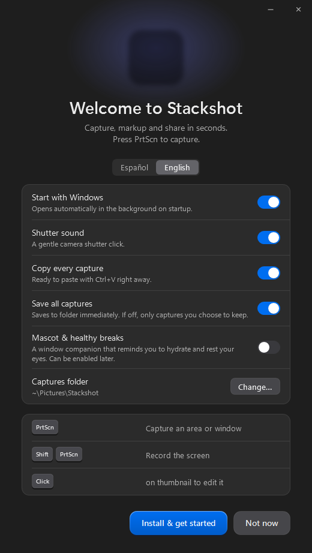
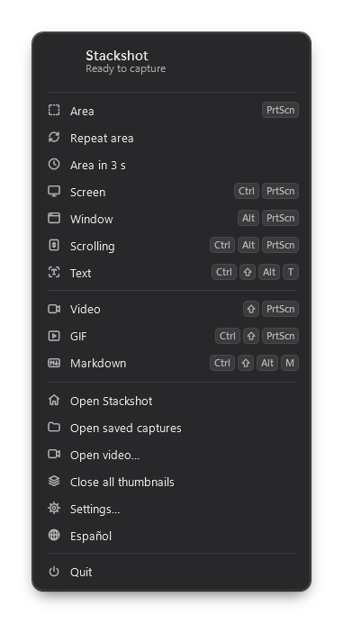
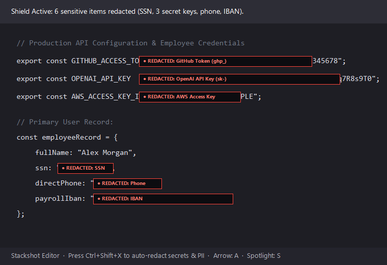
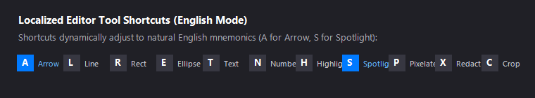

# Stackshot: New Features Guide & Tutorial

This guide provides a walkthrough of the new features added in the `feature/multi-language-support` release, explaining what each feature does, how to use it, and how it protects your sensitive information and speeds up your workflow.

---

## 1. Multiple Language Architecture & German (Deutsch) Support

### What it is
Stackshot now features a comprehensive **multi-language localization engine** with first-class support for **German (Deutsch)** alongside English and Spanish. 

- **German Localization Engine** ([`src/I18n.German.cs`](file:///d:/GitHub/stackshot/src/I18n.German.cs)): Houses a dedicated translation catalog translating navigation items, settings pages, editor buttons, dialogs, notices, and toasts into natural German.
- **Dynamic Language Detection**: In **Automático / Auto** mode, Stackshot automatically matches your Windows display language:
  - German Windows (`de-DE`, `de-AT`, `de-CH`) -> German (`de`)
  - Spanish Windows (`es-ES`, `es-MX`, `ca-ES`, `gl-ES`, `eu-ES`) -> Spanish (`es`)
  - All other display languages -> English (`en`)
- **Settings Selector**: Under **Settings › General › Appearance › Language** (*Ajustes › General › Apariencia › Idioma* / *Einstellungen › Allgemein › Erscheinungsbild › Sprache*), you can explicitly choose between **Automático**, **Español**, **English**, and **Deutsch**.

---

## 2. First-Run Language Selector (Welcome Screen)

### What it is
When Stackshot is run for the first time or unpacked as a portable binary, it opens the **Welcome** onboarding sheet. Stackshot features an immediate **language selector control** prominently located right under the welcome banner.

### How to use
1. Launch [`Stackshot.exe`](file:///d:/GitHub/stackshot/bin/Stackshot.exe) on a fresh system or run it with `--welcome`.
2. Notice the segmented language selector pill (`[ Español | English | Deutsch ]`) right beneath the title.
3. Click **English**, **Español**, or **Deutsch** to switch the interface.
4. The entire setup wizard re-renders immediately in the selected language, while preserving all your selected toggles (startup options, screenshot hotkeys, sound, and save paths).

---

## 3. One-Click Language Switcher in System Tray

### What it is
Switching languages no longer requires navigating through multiple settings tabs (*Ajustes › General › Apariencia › Idioma*). The system tray popup menu includes a dedicated **Language switcher item** with a globe icon.

### How to use
1. Click the Stackshot icon in your Windows notification tray (next to the clock).
2. Click the language button to cycle smoothly between **English**, **Deutsch**, and **Español**.
3. Stackshot dynamically switches the active language across all surfaces—including open windows, editor toolbars, floating thumbnail cards, and background OCR services—**without requiring an application restart**.

---

## 4. Developer Secrets & International PII Redaction

### What it is
The **Sensitive Data Shield** ([`src/Capture/Sensitive.cs`](file:///d:/GitHub/stackshot/src/Capture/Sensitive.cs)) automatically identifies and redacts international personal data and developer secrets:

- **Cloud & API Secrets**:
  - **GitHub Personal Access Tokens**: Classic (`ghp_...`, `gho_...`, `ghu_...`, `ghs_...`, `ghr_...`) and Fine-Grained tokens (`github_pat_...`).
  - **OpenAI & Anthropic API Keys**: `sk-proj-...`, `sk-ant-...`, `sk-admin-...`, `sk-...`.
  - **Amazon Web Services (AWS)**: Access Key IDs (`AKIA...` and `ASIA...`).
  - **Private Cryptographic Keys**: Headers and keys matching `-----BEGIN ... PRIVATE KEY-----`.
  - **Slack Workspace Tokens**: `xoxb-...`, `xoxp-...`, `xapp-...`.
- **International Personal Data (PII)**:
  - **US Social Security Numbers (SSN)**: Standard 3-2-4 layout (`XXX-XX-XXXX`) validated against official Social Security Administration rules.
  - **German & International IBANs**: German IBAN format (`DE22`) and international banking numbers verified with mod 97-10 check digits.
  - **International Phone Numbers**: Formatted domestic numbers like `(555) 234-5678` or `555-234-5678` with phone labels, and international dialing codes (`+1`, `+44`, `+34`).
  - **Bank Cards**: Formatted card numbers (Luhn algorithm validated).
  - **Spanish Identity Documents**: DNI, NIE, and Social Security numbers.

### How to use
1. Take a screenshot containing code, terminals, or documents: press <kbd>Print Screen</kbd>.
2. In the floating thumbnail, click the **Edit** icon (or press <kbd>Ctrl</kbd> + <kbd>E</kbd>).
3. In the Editor toolbar, click **Sensitive data** (the shield icon) or press the shortcut <kbd>Ctrl</kbd> + <kbd>Shift</kbd> + <kbd>X</kbd>.
4. All secrets, tokens, SSNs, and phone numbers are instantly covered with non-destructive black redaction boxes.
5. If you want to reveal a specific item, simply click its redaction box and press <kbd>Delete</kbd> or <kbd>Backspace</kbd>.

> [!TIP]
> **Automatic Background Redaction**: You can enable automatic redaction for every capture under **Settings › General › Sensitive data** (*Ajustes › General › Datos sensibles* / *Einstellungen › Allgemein › Sensible Daten*). When enabled, personal data and developer secrets are redacted before the screenshot even reaches your clipboard!

---

## 5. Localized Hotkeys & Dynamic Mnemonics in the Editor

### What it is
Editor shortcuts adapt to your active language ([`src/Editor/Editor.cs`](file:///d:/GitHub/stackshot/src/Editor/Editor.cs)):

| Tool | English Key | Spanish Key | German Key | Description |
|---|:---:|:---:|:---:|---|
| **Arrow** | <kbd>A</kbd> | <kbd>F</kbd> (*Flecha*) | <kbd>A</kbd> / <kbd>F</kbd> (*Pfeil*) | Draw directional indicator arrows |
| **Line** | <kbd>L</kbd> | <kbd>L</kbd> (*Línea*) | <kbd>L</kbd> (*Linie*) | Draw straight lines |
| **Rectangle** | <kbd>R</kbd> | <kbd>R</kbd> (*Recuadro*) | <kbd>R</kbd> (*Rechteck*) | Draw bounding boxes |
| **Ellipse** | <kbd>E</kbd> | <kbd>E</kbd> (*Elipse*) | <kbd>E</kbd> (*Ellipse*) | Draw circles and ovals |
| **Text** | <kbd>T</kbd> | <kbd>T</kbd> (*Texto*) | <kbd>T</kbd> (*Text*) | Add text callouts |
| **Numbers / Counter** | <kbd>N</kbd> | <kbd>N</kbd> (*Números*) | <kbd>N</kbd> (*Zahlen*) | Numbered sequence badges (1, 2, 3...) |
| **Highlight** | <kbd>H</kbd> | <kbd>H</kbd> (*Resaltar*) | <kbd>H</kbd> (*Hervorheben*) | Fluorescent text highlighter |
| **Spotlight** | <kbd>S</kbd> | <kbd>O</kbd> (*Foco*) | <kbd>S</kbd> (*Scheinwerfer*) | Dims the rest of the canvas |
| **Pixelate** | <kbd>P</kbd> | <kbd>P</kbd> (*Pixelar*) | <kbd>P</kbd> (*Verpixeln*) | Mosaic blurring |
| **Redact** | <kbd>X</kbd> | <kbd>X</kbd> (*Tapar*) | <kbd>X</kbd> (*Schwärzen*) | Solid black privacy cover |
| **Crop** | <kbd>C</kbd> | <kbd>C</kbd> (*Recortar*) | <kbd>C</kbd> (*Zuschneiden*) | Resize and trim canvas |

> [!NOTE]
> All hotkeys (<kbd>A</kbd>/<kbd>F</kbd> for Arrow, <kbd>S</kbd>/<kbd>O</kbd> for Spotlight) work seamlessly across all language modes.

---

## 6. Dynamic UI-Aware OCR Engine

### What it is
Stackshot integrates directly with Windows 10 and 11's built-in OCR subsystem ([`src/Capture/Ocr.cs`](file:///d:/GitHub/stackshot/src/Capture/Ocr.cs)). The recognition engine actively inspects your current UI setting:

- In **German mode**, it prioritizes German OCR recognition (`de-DE`, `de-AT`, `de-CH`), accurately detecting umlauts (`ä`, `ö`, `ü`) and Eszett (`ß`).
- In **English mode**, it prioritizes English OCR recognition (`en-US`, `en-GB`), improving accuracy for technical terms, camelCase code identifiers, and English prose.
- In **Spanish mode**, it prioritizes Spanish recognizers (`es-ES`, `es-MX`), accurately detecting characters like `ñ`, accented vowels (`á`, `é`, `í`, `ó`, `ú`), and inverted punctuation (`¿`, `¡`).
- When a language pack is not installed on Windows, it gracefully falls back to the user's installed profile languages.
